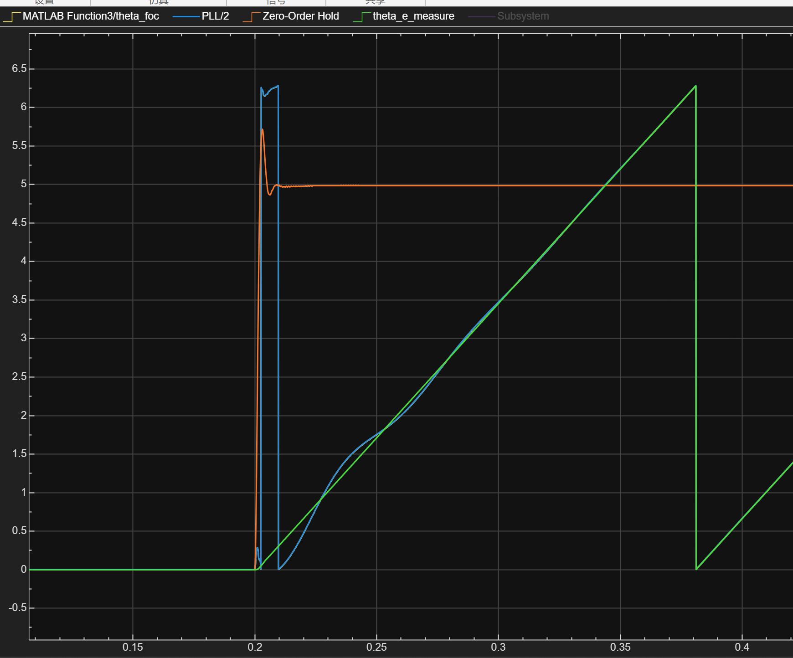
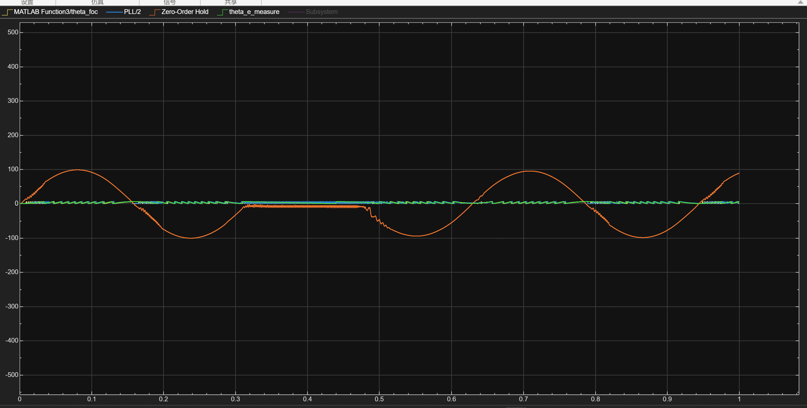
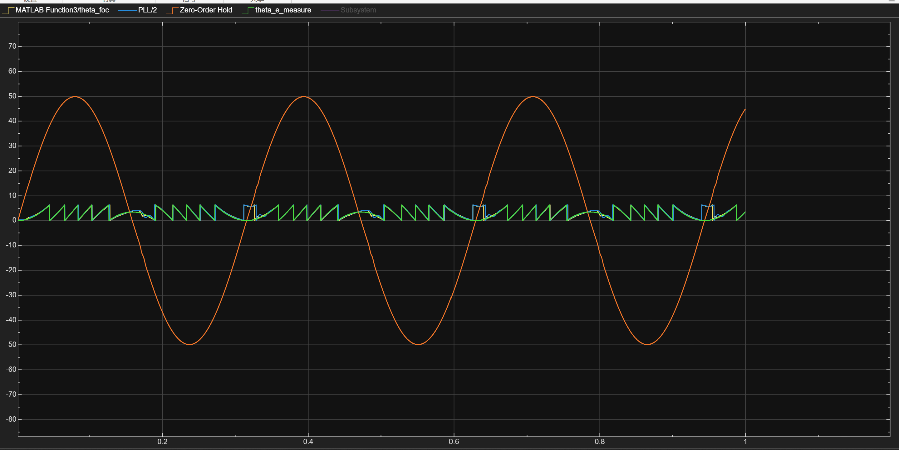

# 基于 Simulink 的无感 FOC 仿真

这个仓库是我学习 FOC 算法过程中的记录，包含一套 Simulink 模型、一份算法推导和一份调试
笔记，以及有感阶段的早期存档，一并开源分享出来。模型从有感 FOC 搭起（Clarke/Park 变换、
SVPWM、双电流环、前馈解耦），再把角度来源换成观测器：低速用高频正弦注入，高速用
反电动势观测，中速段把两个观测器的结果融合起来。

| 0 → 5 rad/s 阶跃 | 100 rad/s 幅值、20 rad/s 频率 |
| --- | --- |
|  |  |

---

## 一、模型里有什么

`motor_simulink.slx` 是完整模型，一个控制周期（10 kHz）内的信号流如下：

```
速度环:    ω_ref -->(+)--> P=2 (A/(rad/s)) --> 限幅 ±80 A --> iq_ref
                     ^-                              |
                     |                            ωm (来自电机)
电流环 d:  id_ref -->(+)--> PI_d -->(+)--> vd
                     ^-              ^
                    id             Vd_ff = -ωe·Lq·iq
电流环 q:  iq_ref -->(+)--> PI_q -->(+)--> (+) --> vq
                     ^-              ^       ^
                    iq             Vq_ff   inj_out = Vh·sin(ωh·t)·g
调制:      (vd, vq) --> Park^-1(θ_foc) --> SVPWM(Vdc, Ts) --> (da,db,dc) --> 逆变器 --> PMSM
反馈:      ia,ib,ic --> Clarke --> iα,iβ --> Park(θ_foc) --> id,iq
观测:      iα,iβ --> HFI 跟踪环 --> θ_hfi
           Vα,Vβ,iα,iβ --> 磁观测 PLL --> 自适应相位补偿 --> θ_comp
调度:      Supervisor(ωm, θ_hfi, θ_comp) --> θ_foc, g
```

采样、Clarke、Park、电流误差、PI + 前馈 + 注入、反 Park、SVPWM 依次执行，
HFI 跟踪环与磁观测 PLL 并行计算，最后由 Supervisor 给出本周期使用的角度和注入增益。
注入加在 d 轴指令电压上，所以 `vd` 通路上还有一个加法器。

Supervisor 的调度规则：

| 机械速度 | 角度来源 | 注入增益 |
| --- | --- | --- |
| `\|ωm\| <= 8` | HFI | 1.0 |
| `8 < \|ωm\| < 15` | sin/cos 加权融合 | 1.0 |
| `15 <= \|ωm\| < 25` | 磁观测 | 1.0 → 0.3 线性 |
| `\|ωm\| >= 25` | 磁观测 | 0.3（保温） |

两个门限与观测器各自的有效区间对应：HFI 的误差信号幅值有上限，能指令的最高电角速度
约 53 rad/s（≈7.5 rad/s 机械）；磁观测在反电动势低于 0.05 V 时进入死区（≈4.5 rad/s 机械）。
两段之间留出重叠带，就是 8~15 rad/s 的融合区。

有感方案在同一套电流环与 SVPWM 上，把 Park / 反 Park 的角度来源换成真实电角度即可，
模型里 `theta_e_measure` 已经接入观测器和示波器。

---

## 二、怎么运行

需要 MATLAB R2025b（模型由 25.2 保存）、Simulink 和 Motor Control Blockset
（电机与逆变器使用 `mcblib` 中的 `Interior PMSM`、`Average-Value Inverter`）。

1. 打开 `motor_simulink.slx`，仿真步长固定 `1e-4 s`，`StopTime` 默认 1 s。
2. 确认顶层常量：`Vdc = 24 V`、`Ts = 1e-4 s`、`id_ref = 0`。
3. 速度给定在 `Sine Wave1`，幅值与频率的单位都是 rad/s，默认复现 50 rad/s 幅值工况。
4. 常用示波器（编号为 `FOC contral` 内部编号）：
   - `Scope7`：融合角度、PLL(HFI) 角度、速度、真实电角度、观测器角度，测试波形取自这里；
   - `Scope3`：`iq_ref`、Park 解算的 `iq`、电机真实 `iq`、q 轴 PI 输出；
   - `Scope5`：`Vq_ff` 与合成后的 `vq`；
   - `Scope6`：`id_ref` 与 `id`。
5. 复现失效工况：把 `Sine Wave1` 幅值改为 100、频率改为 20，观察过零段的表现。

`motor_simulink2.slx` 是有感阶段的早期存档，保留在这里便于对照，不参与主模型的验证。

---

## 三、算法实现要点

**1. HFI 的误差提取。** 注入在 d 轴，估计坐标系下 `id̂` 带一个与位置误差无关的 `L0` 偏置、
`iq̂` 带 `L1·sin2Δθ`，两路分别带通、乘载波解调、低通后得到 `Ed`、`Eq`，
用 `ε = 0.5·atan2(Eq, Ed)` 提取误差。小误差区线性化后的增益为 `(Lq-Ld)/(Lq+Ld)`，
本机参数下是 0.106，因此跟踪环使用了较大的 `Kp = 1000`。`(Ed, Eq)` 的轨迹被限制在
半径 `|L1|` 的圆上，`ε` 的幅值上限约 0.053 rad，对应的速度指令上限即前面提到的 53 rad/s。

**2. 磁观测利用 `E = V - Rs·I`。** 省略了 `L·di/dt` 项。这一项在稳态下等于 `j·ωe·Lq·iq`，
方向在 d 轴，使反电动势矢量额外转过 `atan(Lq·iq/λ)`：50 rad/s、5 A 时约 20.6°。
该误差与转速无关、与 `iq` 成正比，正弦激励下会随电流同频摆动，因此后续加入了
按转速调度的相位补偿。

**3. 融合在 sin/cos 域完成。**
`θ_foc = atan2(α·sinθ_hfi + (1-α)·sinθ_comp, α·cosθ_hfi + (1-α)·cosθ_comp)`，
等价于两个单位矢量的加权和再取相角（圆均值）。角度在 `0/2π` 处会发生卷绕，
直接对角度加权会在跨零时跳变 2π；圆均值在跨零处连续，切换点不会引入阶跃。
它处理的是切换连续性，两个观测器各自的相位偏差仍由各自的补偿环节负责。

**4. 高速段保留 0.3 倍注入。** PLL 在高速段不完全休眠，重新进入低速区时可以省去一次
约 50 ms 的锁定过程。代价是残余载波会进入磁观测：50 rad/s 时约 15.7 mV，
相对 `|E| = 0.56 V` 为 2.8%，折合约 1.6° 的角度纹波，按 0.3 倍注入约为 0.5°。

完整的推导（SVPWM 占空比、滤波器频响、相位补偿解析式、参数来源）在
[`docs/algorithm-design.md`](docs/algorithm-design.md)。

---

## 四、测试结果

同一套模型参数，只改变速度给定。

| 工况（幅值 / 频率） | 加速度峰值 | 结果 | 波形 |
| --- | --- | --- | --- |
| 0 → 5 rad/s 阶跃 | - | 速度超调约 14%，稳定时间约 50 ms，角度约 45~60 ms 后重合 | `0-5阶跃速度测试.png` |
| 50 / 10 rad/s | 500 rad/s^2 | 速度闭环跟踪 | `50rad，10rad-s的速度闭环波形.png` |
| 50 / 20 rad/s | 1000 rad/s^2 | 速度与角度均跟踪 | `50rad，20rad-s频率的测试波形.png` |
| 100 / 15 rad/s | 1500 rad/s^2 | 全周期跟踪 | `100rad,15rad-s频率无感foc测试波形.png` |
| 100 / 20 rad/s | 2000 rad/s^2 | 过零段速度停在 0 附近，随后发散 | `100rad,20rad-s频率的测试波形.png` |
| 50 / 50 rad/s | 2500 rad/s^2 | 速度失控至约 110 rad/s 并振荡 | `50rad，50rad-s频率的测试波形.png` |



读图说明：橙线是速度通道（`Zero-Order Hold`），绿线是真实电角度，蓝线是融合后的角度，
浅蓝是 PLL 输出。角度在 0~2π 之间卷绕，呈锯齿状属于正常现象。

从几组波形可以看到：

- 阶跃工况里速度超调到 5.7 rad/s 左右，速度稳定与角度重合的时间都在 50~60 ms 量级，
  大致对应 HFI 的锁定时间。
- 100/20 工况中，速度在 0.3~0.5 s 停在 0 附近：过零段反电动势符号翻转，
  磁观测进入死区，此时主要由 HFI 提供角度，而它的锁定过程尚未完成。
- 50/50 工况下速度已偏离给定，角度通道呈高频交织，无法判读，属于失稳工况。
- 100 rad/s 超过 3508 在 24 V 下的空载转速（482 rpm ≈ 50.5 rad/s，见
  `测试波形/搭配c620的理论速度上限参数.png`），该工况位于硬件包络之外，
  用于观察算法的边界。

---

## 五、调试记录

完整记录在 [`docs/debugging-notes.md`](docs/debugging-notes.md)，每条按
"现象 → 原因 → 处理 → 遗留"整理，包括：

1. HFI 在高速段发散：反电动势增大后注入信号占比下降，带通对基频只有约 -40 dB 抑制，
   解调结果被基频泄漏污染。
2. HFI 需要使用自己输出的角度闭环 FOC：注入与解算在同一坐标系下，观测器才能成立；
   为此在观测器内部对 `αβ` 电流做 Park 变换。
3. 有感阶段的调参问题：电机参数（`L`、`λ`、`J`、`B`、负载）与实际不符时会出现转速卡死、
   电流环振荡等现象；前馈模块中保留了从 `1.5e-5` 改到 `1.2e-4` 的注释。
4. HFI 依赖凸极：`Ld = Lq` 时误差信号恒为零，角度无法锁定。
5. 融合段的四个问题：两个观测器各有 0.5~2° 相位差、单点切换会引入阶跃、
   注入会给磁观测带来包络噪声、每次进入低速区需要约 50 ms 重新锁定。
6. 无感 FOC 的适用工况：主流无感应用多为单向稳态运行，机器人关节与轮毂电机通常采用
   双编码器有感方案，验收标准需要按无感方案的特点单独设定。
7. 相位补偿：滤波器相位滞后属于乘性相位，提高 PLL 增益无法替代补偿，需要按解析式处理。
8. 正弦注入与方波注入的取舍：最初使用方波注入，解调不便、可用激励上限较低，后改为正弦注入。
9. 整理模型时补充发现的几处：前馈参数注释与模型现值不一致、带通中心在 847 Hz 而注入为
   1 kHz、磁观测低通的直流增益为 31.8、d/q 两轴电流环积分增益相差 250 倍、
   模型中存在未接线的备用模块。

---

## 六、关键参数

| 参数 | 值 | 说明 |
| --- | --- | --- |
| `Vdc` / `Ts` | 24 V / 1e-4 s | 3508 额定电压；控制与仿真同周期 |
| 极对数 / `Rs` | 7 / 0.194 Ω | 3508 数据手册 |
| `Ld` / `Lq` | 9.7e-5 / 1.2e-4 H | 手册相电感，并按凸极需求设置差异 |
| `lambda_pm` | 0.0016 Wb | 模型现值，与手册反推值不一致，见第七节 |
| `J` / `B` | 5e-5 kg·m^2 / 1e-4 N·m·s/rad | 模型现值 |
| 电流环 `Kp` / `Ki`(d, q) | 0.2 / 0.0002, 0.05 | 仿真整定，输出限幅 ±9.5 V |
| 速度环 `Kp` | 2 A/(rad/s) | 纯 P，限幅 ±80 A |
| 注入 `Vh` / `fh` | 0.2 V / 1 kHz | 高频电流约 0.33 A |
| HFI 环 `Kp` / `Ki` | 1000 / 20 | 输出限幅 ±200 rad/s |
| 磁观测环 `Kp` / `Ki` | 15000 / 10 | 输出限幅 ±100 rad/s |
| 融合门限 / 注入降额 | 8, 15 rad/s / 0.3 | 机械速度 |

参数来源分级（手册值、仿真整定值、待辨识值）写在
[`docs/algorithm-design.md`](docs/algorithm-design.md) 第 9 节。

---

## 七、已知限制

- 逆变器采用平均电压模型，未包含开关纹波、死区与开关延时；真机上这些因素会影响低速观测。
- 磁观测的 `Vα/Vβ` 取自反 Park 的指令电压，未做逆变器非线性补偿。
- 电机块的 `lambda_pm = 0.0016 Wb` 与 3508 手册（0.3 N·m/A、24.48 rpm/V）反推的磁链
  存在数量级差异，因此速度、转矩、加速度的绝对值不代表真机，适合做算法之间的相对比较。
- 电流环积分较弱（d 轴 `Ki = 0.0002`、q 轴 `0.05`），未启用抗积分饱和，稳态误差主要由前馈承担。
- 模型中保留了若干未接线的备用模块（位置环输出、`pre_sync_selector`、
  `phase_compensation_hfi`，`sync_enable` 恒为 0），当前闭环不使用它们。
- HFI 带通极点对应 847 Hz，注入频率为 1 kHz，1 kHz 处相移约 +2.2°。

---

## 八、后续可能做的事

- 整理 Simulink 的连线与组件，把未接线的备用模块清理或接通。
- 优化算法与参数：补充 `L·dI/dt`、重新设计带通、调整融合判据。
- 换用更合适的电机参数，重新做一轮优化与测试。

以上都没有排期，遇到合适的机会再继续。

---

## 九、参考

- [SguanFOC](https://github.com/Sguan-ZhouQing/SguanFOC_Library)（MIT）：本工程的算法框架
  参考对象，它是一个面向嵌入式平台的 C 语言库，这里是把它在 Simulink 里重搭并做参数分析。
- DJI M3508 / C620 的公开参数（电机参数表、转速上限）。
- MATLAB/Simulink 与 Motor Control Blockset 提供的电机、逆变器模型。

---

## 十、许可

[MIT](LICENSE)。与参考项目 SguanFOC 的许可证一致。

---

## English

A Simulink study of sensored and sensorless FOC for a PMSM, written while learning the
algorithm and rebuilding the structure of SguanFOC in simulation. Low speed uses a 1 kHz
sinusoidal d-axis HFI; high speed uses a voltage-model back-EMF observer with a normalized
PLL and adaptive phase compensation; the hand-over band uses sin/cos weighted fusion, and a
reduced-amplitude carrier is kept alive to avoid re-lock transients. The test set covers
step and sinusoidal speed references up to 2500 rad/s^2 peak acceleration, and the measured
HFI re-lock time is roughly 50 ms.
